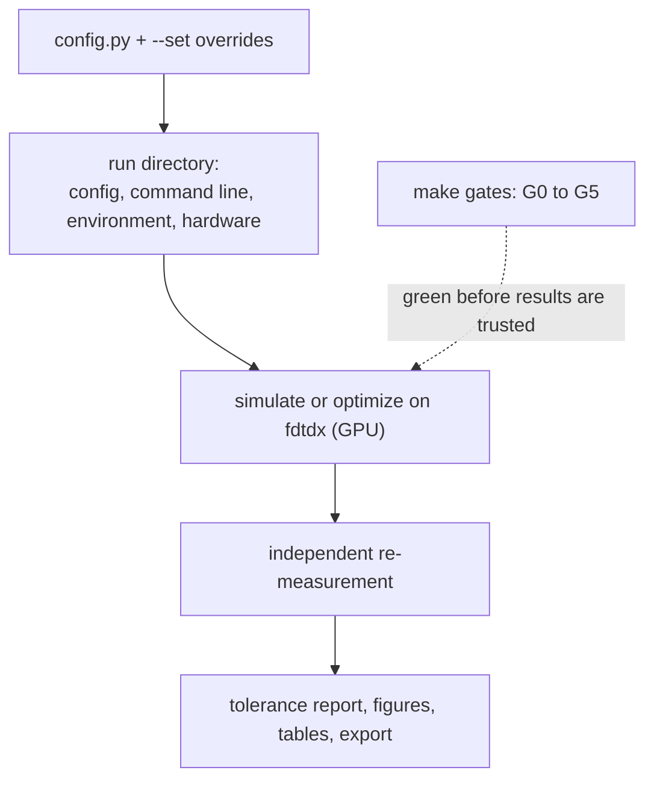

> **English** · [繁體中文](README.zh-TW.md)

# invdx

**A GPU FDTD toolbox for passive photonic devices, built so its numbers can be checked.**

invdx simulates devices on [fdtdx](https://github.com/ymahlau/fdtdx) (JAX,
GPU, differentiable) and checks that engine against
[Meep](https://github.com/NanoComp/meep), an independent FDTD code reached
through a subprocess bridge. Six verification gates, from unit tests to
fdtdx-vs-Meep agreement, have to pass before results are trusted, and the
measurement and optimization scripts record each run's config, command
line, environment and hardware. On that base sit adjoint gradients and an
inverse-design loop, fabrication-tolerance analysis, and export to GDS and
other solvers. Inverse design is one feature among these, not the whole
toolbox.

[](LICENSE)
[](pyproject.toml)

## What it does

| | What you get | Start here |
|---|---|---|
| **Simulate on the GPU** | quasi-2D and full-3D fdtdx scenes; a whole spectrum from one pulsed run; a forward-only fast path about 2× faster than stock fdtdx, with bit-identical fields | `src/invdx/engines/` |
| **Cross-check on a second engine** | Meep 1.34 (CPU, MPI), built from source and called only as a separate program; 2D measurement tasks (slab transmission, vacuum flux, photonic-crystal bend); every convention difference between the two engines written down in one module | `src/invdx/engines/conventions.py` |
| **Verify the toolchain** | six gates G0–G5 (table below); a missing prerequisite makes a gate fail, never skip | `make gates` |
| **Adjoint gradients and inverse design** | gradients through the whole FDTD run, checked against finite differences; an Adam loop for any differentiable parameterization; density → conic filter → tanh projection with a β schedule; resume after a crash, Slurm requeue | [docs/optimize.md](docs/optimize.md) |
| **Fabrication tolerance** | per-voxel sensitivity map, eroded / nominal / dilated corners, linewidth against the minimum-feature rule | [docs/tolerance.md](docs/tolerance.md) |
| **Export** | GDS-II with a minimum-feature self-check and a geometry fingerprint; a tool-neutral bundle (permittivity grid, design vector, spectra, manifest with units and checksums); VTK for ParaView | `src/invdx/export/` |
| **Datasets** | batch forward simulations saved as npz shards plus a manifest, resumable, for training surrogate models | `scripts/17_generate_dataset.py` |
| **Learn the method** | a small self-written 2D FDTD you can read in one sitting, a lesson porting it to JAX, a lesson on your first adjoint gradient | [tutorials/](tutorials/) |
| **Reproduce a run** | locked environments (uv for JAX/fdtdx, spack for Meep); simulation scripts write `runs/<timestamp>-<name>/` with config, command line, environment and a hardware probe | [docs/env.md](docs/env.md) |

## Results so far

| Measured | Result | Source |
|---|---|---|
| fdtdx vs Meep vs analytic (G5: dielectric slab, normal incidence) | T = 0.7441 / 0.7423 / 0.7398; fdtdx and Meep 0.24% apart | [journal](docs/journal.md), 2026-08-17 |
| adjoint vs finite differences on the coupler's real design path (G2 Part C) | 0.0008%, 0.18% and 0.07% relative error on three voxels (gate: 5%) | [journal](docs/journal.md), 2026-08-17 |
| forward vs reverse coupling efficiency (G4) | 0.08 dB apart at CE = −9.77 dB (gate: 0.5 dB) | commit `1b326e5` |
| fast forward path vs stock fdtdx | 640 → 1245 Mcell-steps/s (1.94×) at 8.0M cells; 653 → 1529 (2.34×) at 16.8M cells; fields bit-identical | `src/invdx/engines/fdtdx_perf.py` |
| largest forward run on one 24 GB card | 15.6M cells with stock fdtdx (out of memory at 27M); 64M cells with the fast path and memory reclaim | `src/invdx/engines/fdtdx_perf.py` |
| adjoint memory | peak ≈ (372.18 + 268.0329·C) bytes per cell, C = gradient checkpoints; the slope is the same on Turing and Ada | [RETRACTIONS](docs/RETRACTIONS.md), 2026-08-22 |
| photonic-crystal 90° bend (toy engine) | Γ-X stopband (T < −20 dB) at a/λ = 0.255–0.41, containing the literature gap 0.29–0.41; in-gap bend transmission 0.84–1.15 (above 1 is the toy engine's normalization noise) | `make phc-bend`, [walkthrough](docs/phc-bend-walkthrough.md) |
| grating-coupler inverse design | every stage of the loop has run end to end, the optimization itself at the reference recipe (0.8 ps, 20 nm grid); the full-scale runs so far were stopped before converging, so **no finished coupler design is claimed** | [journal](docs/journal.md), 2026-08-17 |

CE is coupling efficiency. Everything here is simulation; nothing has been
compared against a fabricated device.

### Hardware these results come from

- GPU: NVIDIA Quadro RTX 6000, NVIDIA RTX 6000 Ada Generation
- CPU: AMD Ryzen 9 7950X, dual-socket Intel Xeon Gold

## Example problems

Two problems ship with the repo. They are the examples the tools are
exercised on, not the limit of what fits.

- **`grating_coupler`**: a fiber-to-chip grating coupler on 220 nm SOI in
  the O-band (centre wavelength 1.31 µm), fed by a Gaussian fiber mode at
  θ = 10° in the reference recipe (θ is the fiber incidence angle; θ = 0 is
  vertical), with design rules for a 193 nm DUV process. Quasi-2D and
  full-3D coupling-efficiency chains with an analytic slab TE0 target. Its 2D
  coupling peak is checked against a Meep reference value hard-coded in
  `scripts/03_grating_coupler_baseline.py`; the Meep run that produced that
  value is not part of this repo. This is the problem the inverse-design
  driver, the re-measurement, the tolerance report and the exporters are
  wired to.
- **`phc_bend`**: the classic photonic-crystal 90° bend (square lattice of
  rods, a = 1 µm, R = 0.225a, ε = 10), in the spirit of Mekis et al.,
  Phys. Rev. Lett. 77, 3787 (1996), run on the toy engine and on Meep.
  Hands-on: [docs/phc-bend-walkthrough.md](docs/phc-bend-walkthrough.md).

To add your own device, follow [docs/new-problem.md](docs/new-problem.md):
a problem is a config subclass plus one `PROBLEM = ProblemSpec(...)`
declaration, and with that it inherits the two gates that measure a concrete
device (G2 Part C, G4), or declines them in writing.

## What fits, and what does not

All three engines solve FDTD on a uniform Cartesian grid, and every adapter
gives each material one real, constant permittivity. That decides the class
of device.

**Fits today:** passive, linear, lossless dielectric devices whose figure of
merit is a ratio of two runs (the device run divided by a reference run):
grating couplers, splitters and MMIs, crossings, tapers and bends, mode
converters, (de)multiplexers, ring filters, photonic-crystal structures,
metasurface unit cells. Each new device needs a scene builder and a
measurement function.

**Needs new engine work:** dispersive or lossy materials (so metals and
plasmonics), nonlinear optics, gain and active devices including every kind
of modulator, anisotropic or magneto-optic media, permittivity that varies
in time, thermal or electrical co-simulation, non-uniform meshes,
band-structure (eigenmode) calculations.

Know these before you start:

- **The Meep cross-check stops at 2D.** The bridge only has 2D measurement
  tasks, so a 3D device can be simulated and optimized on fdtdx but not yet
  checked against Meep. That is a missing bridge task, not a physics limit.
- **Ports need a mode you can write down.** The shipped targets are an
  analytic slab TE0 mode and a Gaussian fiber mode. There is no numerical
  mode solver in the chain, so other port modes have to be supplied (MPB can
  compute them).
- **One run has to fit on one GPU.** With the adjoint memory model above (GB
  = 10⁹ bytes) and a 16 GB budget (the largest adjoint run known to fit on
  the 24 GB card peaked at 15.4 GB), C = 10 leaves room for about 5.2M
  cells: a 3.5 µm cube at 20 nm spacing. fdtdx has no true 2D, so a "2D"
  scene keeps a thin periodic y axis (4 cells by default) and costs that
  many times its in-plane cell count. A whole 100 µm metasurface aperture is
  far out of reach; its unit cell fits easily.
- **Inverse design needs a differentiable figure of merit and continuous
  variables.** The optimizer takes any `vg_fn(p, beta) -> (loss, dloss/dp)`.
  The shipped parameterization is a density on a pixel grid; a geometric one
  (say, a vector of tooth widths) needs its own smooth rasterizer. Discrete
  choices, such as an integer number of teeth, are out.
- **The application tools are wired to the coupler example today.**
  `make verify`, `make tolerance`, `make handoff`, the GDS exporter and the
  dataset generator read grating-coupler runs. The engines, gates,
  optimizer, fabrication filters and toy engine are problem-independent.
- **Smaller gaps:** a field map is a second, explicitly requested run
  (`make verify RUN=runs/<dir> ARGS=--field`), not a by-product of the first;
  there is no lithography model (manufacturability means linewidth rules
  plus eroded and dilated corners); design rules are typed into the config
  by hand; the toy engine uses a first-order Mur boundary, so it is for
  learning and cross-checks, not for design.

## Quickstart

```bash
bash scripts/bootstrap.sh   # install and verify layer L1 (uv, JAX, fdtdx)
make test                   # unit tests, CPU only
make phc-bend               # photonic-crystal bend benchmark, toy engine, CPU (~2 min)
make gates                  # all six gates: G1-G4 need a GPU, G5 also needs Meep
```

`scripts/bootstrap.sh` checks the GPU driver against the pinned CUDA wheels
before installing anything and verifies the result by importing it
(`--cpu-only` skips the GPU part). Meep is built from source with spack
(`bash spack/bootstrap.sh`, hours on a cold cache; see
[docs/env.md](docs/env.md)). Until it is, run the gates that do not need it:

```bash
uv run python scripts/00_check.py --through reciprocity   # G0-G4, no Meep
```

| I want to… | Command | Read more |
|---|---|---|
| reproduce a literature benchmark | `make phc-bend` | [walkthrough](docs/phc-bend-walkthrough.md) |
| learn where an adjoint gradient comes from | `uv run python scripts/09_toy_adjoint.py` (CPU, 1–3 min) | [tutorials/](tutorials/) |
| try the optimization loop on the bundled coupler example | `make coupler-opt-smoke` (GPU, ~10 min); a full round is `make coupler-opt` (~13 h) | [docs/optimize.md](docs/optimize.md) |
| re-measure a finished design independently | `make verify RUN=runs/<dir>`, optionally `ARGS="--corners --s11"` | [docs/optimize.md](docs/optimize.md) |
| see how a design survives fabrication error | `make tolerance RUN=runs/<dir>` | [docs/tolerance.md](docs/tolerance.md) |
| hand a design to another solver | `make handoff RUN=runs/<dir>` | [docs/README.md](docs/README.md) |
| simulate my own device | copy `src/invdx/problems/phc_bend.py`, the smaller of the two | [docs/new-problem.md](docs/new-problem.md) |

`make help` lists every target, and `make runs` says which run directories
can be fed to `RUN=`. `scripts/` is numbered by topic: 00 is the gate
runner, 01–02 smoke tests, 03–05, 07 and 15–21 the grating-coupler example,
06 and 11 photonic crystals, 08–09 the two lessons, 10 and 12–14
benchmarks.

## Verification gates

`make check` runs G0 only; `make gates` runs all six in order, and each gate
assumes the ones before it passed. Each run writes a machine-readable
`gates_report.json`.

| Gate | What it checks | Needs |
|---|---|---|
| G0 unit | the whole `tests/` suite: overlaps, filters, toy physics, geometry, design-vector round trips, checkpoint and resume | CPU |
| G1 api | the fdtdx API this repo uses, a GPU visible to JAX, and a ping through the Meep bridge when Meep is installed | GPU |
| G2 gradcheck | adjoint gradients against finite differences: the filter chain rule, a toy cell, and the real design path of the problem under test (5%) | GPU |
| G3 physics | flux conservation in an empty cell (5%) | GPU |
| G4 reciprocity | forward against reverse coupling efficiency of the problem under test (0.5 dB); this is the gate that caught a factor-2 normalization bug here | GPU |
| G5 cross-engine | fdtdx against Meep and the analytic Airy formula on a dielectric slab (10%) | GPU, Meep |

Treat a red gate as a stop-the-line event. In the verification-and-validation
sense all six are *verification*: they ask whether the code solves its
equations. None is *validation* against a measured device.

Gate reports also record which problem module produced their numbers. That
catches accidents, such as a copied module that kept its old name or a gate
that reports numbers without saying where they came from. It is not a
security boundary: a problem module runs in-process and could write the
report itself. How to read a report from someone else's problem:
[docs/new-problem.md](docs/new-problem.md).

## How it is put together



| Layer | What it holds | Where |
|---|---|---|
| A: engines | fdtdx (GPU, design) and Meep (CPU, reference), version-pinned and used unmodified. Meep runs as a separate program behind the subprocess bridge and is never imported into the invdx process. When a pinned release blocks the work, the fix is a vendored module with attribution rather than a patched package: `fdtdx_fixes.py`, `fdtdx_perf.py`, `fdtdx_checkpoint_buffers.py` | `src/invdx/engines/` |
| B: methodology | config and run directories, the gates, fabrication filters and measurement, mode overlaps, export, cross-engine conventions, problems | `src/invdx/` |
| C: toy | a self-written 2D FDTD, independent of both engines, for learning and as a third opinion | `src/invdx/toy/` |

## Hard-won guardrails (encoded in `engines/conventions.py`)

1. Meep's DFT fields, |alpha|² and fluxes omit the physical ½ power factor.
   A self-written overlap has to bridge that explicitly; skipping it costs a
   factor 2 in CE, and the reciprocity gate is what catches it.
2. `meep.adjoint` multi-frequency gradients arrive as `(Nx, nf)`; sum over
   axis 1.
3. Simulation resolution must be at least the design-grid density, or adjoint
   gradients come back systematically small (measured: 5–8% low at
   resolution 40, exact at 80).
4. Meep's `decay_by` default (1e-11) is about 3.4× slower than 1e-6 at equal
   accuracy, so the worker always passes it explicitly.
5. The config is the single source of truth; scripts never hardcode numbers.
6. Compare resonant structures across engines by **spectral ridge, never by
   a single wavelength**. The engines discretize the same nominal geometry
   into slightly different effective linewidths, and a grating's coupling
   ridge moves faster in wavelength than the edge error itself, so two
   engines can disagree by tens of dB at one wavelength while their ridge
   peaks agree.

## Docs

- [docs/README.md](docs/README.md): the full index.
- [docs/new-problem.md](docs/new-problem.md): add your own device.
- [docs/optimize.md](docs/optimize.md): the inverse-design loop, gradcheck,
  checkpoint and resume, Slurm.
- [docs/tolerance.md](docs/tolerance.md): fabrication-tolerance method and
  reporting conventions.
- [docs/env.md](docs/env.md): the uv and spack environments, and how to
  rebuild them from a clean clone.
- [docs/journal.md](docs/journal.md) and
  [docs/RETRACTIONS.md](docs/RETRACTIONS.md): an append-only log of what was
  measured and where each number came from, and the conclusions later found
  wrong, kept rather than quietly edited away. Read them as part of the
  results.

Every page has a Traditional Chinese twin next to it; `make bilingual` checks
each pair for mechanical drift (code blocks, links, headings), not for prose.

## Engine licenses

invdx is MIT. fdtdx is MIT; the vendored modules listed above carry its
attribution. Meep is GPL-2.0-or-later and is never linked, vendored or
imported into the invdx process: it runs as a separate program behind the
subprocess bridge. The Python dependency tree has three copyleft packages,
all used unmodified: `tidy3d` (LGPL-2.1-or-later, pulled in by fdtdx and
running in the same process) and `certifi` and `tqdm` (MPL-2.0). Full
inventory: [docs/dependencies.md](docs/dependencies.md).

## Citing

Cite invdx through [`CITATION.cff`](CITATION.cff) (or GitHub's "Cite this
repository" button), and cite the engines for the physics: FDTDX (Mahlau et
al., Journal of Open Source Software, 2026) and Meep (Oskooi et al., Computer
Physics Communications, 2010).
