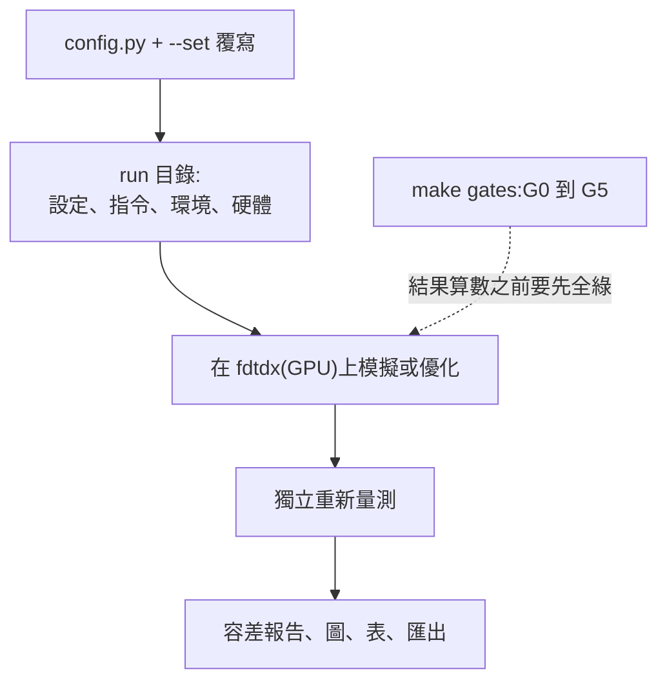

> [English](README.md) · **繁體中文**

# invdx

**給被動光子元件用的 GPU FDTD 工具箱,而且算出來的數字都核對得了。**

invdx 用 [fdtdx](https://github.com/ymahlau/fdtdx)(JAX、GPU、可微分)跑
FDTD(時域有限差分)模擬,再拿 [Meep](https://github.com/NanoComp/meep)
——一支獨立的 FDTD 程式,透過 subprocess bridge 呼叫——去核對這支引擎。從單元
測試到 fdtdx 對 Meep 的一致性,六道驗收關卡(gate)都過了,結果才算數;量測與
優化腳本也會把每次 run 的設定、指令、環境和硬體記下來。在這個基礎上,才是
adjoint(伴隨法)梯度與逆向設計迴圈、製程容差分析,以及匯出到 GDS 與其他
求解器。**逆向設計是其中一項功能,不是整個工具箱。**

[](LICENSE)
[](pyproject.toml)

## 它能做什麼

| | 你會拿到什麼 | 從這裡開始 |
|---|---|---|
| **在 GPU 上模擬** | quasi-2D(第三軸只有薄薄幾格、沒有設計自由度)與完整 3D 的 fdtdx 模擬場域(scene);一次脈衝 run 就拿到整段頻譜;一條只做正向的快速路徑,比原版 fdtdx 快約 2 倍,場值位元完全相同 | `src/invdx/engines/` |
| **拿第二支引擎核對** | Meep 1.34(CPU、MPI),從原始碼建置,只當成一支獨立程式呼叫;bridge 提供的是 2D 量測工作(平板透射、真空通量、光子晶體彎角);兩支引擎之間的每一個慣例差異,都明文寫在同一個模組裡 | `src/invdx/engines/conventions.py` |
| **驗證工具鏈本身** | G0–G5 六道關卡(見下表);缺了前置條件的關卡會直接失敗,不會被跳過 | `make gates` |
| **adjoint 梯度與逆向設計** | 穿過整段 FDTD 時間演化的梯度,並拿有限差分(FD)核對;一支 Adam 迴圈,任何可微分的參數化都能優化;密度 → conic filter → tanh projection,搭配 β 的 schedule;當掉可以續跑,Slurm requeue 也接得回去 | [docs/optimize.zh-TW.md](docs/optimize.zh-TW.md) |
| **製程容差** | 逐 voxel 的敏感度圖、eroded / nominal / dilated 三個 corner、線寬對最小線寬規則 | [docs/tolerance.zh-TW.md](docs/tolerance.zh-TW.md) |
| **匯出** | 帶最小線寬自我檢查與幾何指紋的 GDS-II;一份工具中立的包裹(介電常數網格、設計向量、頻譜、含單位與校驗碼的 manifest);給 ParaView 用的 VTK | `src/invdx/export/` |
| **資料集** | 批次正向模擬,存成 npz 分片加一份 manifest,可以續跑,拿來訓練代理模型(surrogate) | `scripts/17_generate_dataset.py` |
| **學方法本身** | 一支自己寫、一口氣讀得完的小型 2D FDTD,一課把它移植到 JAX,一課算出你的第一個 adjoint 梯度 | [tutorials/](tutorials/) |
| **重現一次 run** | 版本鎖死的環境(JAX/fdtdx 用 uv,Meep 用 spack);模擬腳本會寫出 `runs/<時間戳>-<名稱>/`,裡面有設定、指令、環境和硬體探測結果 | [docs/env.zh-TW.md](docs/env.zh-TW.md) |

## 目前的成果

| 量了什麼 | 結果 | 出處 |
|---|---|---|
| fdtdx 對 Meep 對解析解(G5:介電平板、正入射) | T = 0.7441 / 0.7423 / 0.7398;fdtdx 與 Meep 差 0.24% | [工作日誌](docs/journal.zh-TW.md),2026-08-17 |
| 在耦合器真正的設計路徑上,adjoint 對有限差分(G2 Part C) | 三個 voxel 的相對誤差分別是 0.0008%、0.18%、0.07%(關卡門檻 5%) | [工作日誌](docs/journal.zh-TW.md),2026-08-17 |
| 正向對反向的耦合效率 CE(G4) | 在 CE = −9.77 dB 下兩者差 0.08 dB(關卡門檻 0.5 dB) | commit `1b326e5` |
| 快速正向路徑對原版 fdtdx | 8.0M cell 時 640 → 1245 Mcell-steps/s(1.94 倍);16.8M cell 時 653 → 1529(2.34 倍);場值位元完全相同 | `src/invdx/engines/fdtdx_perf.py` |
| 一張 24 GB 卡上跑得起來的最大正向 run | 原版 fdtdx 是 15.6M cell(到 27M 記憶體就爆掉,OOM);快速路徑加記憶體回收是 64M cell | `src/invdx/engines/fdtdx_perf.py` |
| adjoint 的記憶體 | 峰值 ≈ (372.18 + 268.0329·C) bytes/cell,C 是梯度重算用的 checkpoint 數(不是斷點續跑那種);斜率在 Turing 和 Ada 上一樣 | [RETRACTIONS](docs/RETRACTIONS.zh-TW.md),2026-08-22 |
| 光子晶體 90° 彎角(toy 引擎) | Γ-X 阻帶(T < −20 dB)落在 a/λ = 0.255–0.41,涵蓋文獻的能隙 0.29–0.41;能隙內的彎角透射是 0.84–1.15(超過 1 的部分是 toy 引擎的正規化雜訊) | `make phc-bend`、[動手教學](docs/phc-bend-walkthrough.zh-TW.md) |
| grating coupler 的逆向設計 | 迴圈的每一段都從頭到尾跑過,優化本身用的是參考設定(0.8 ps、20 nm 網格);目前完整尺寸的那幾次 run 都在收斂前就停了,所以**不宣稱有做完的耦合器設計** | [工作日誌](docs/journal.zh-TW.md),2026-08-17 |

CE 是耦合效率(coupling efficiency)。表裡的 cell 即 voxel,也就是網格的
一格。這裡全部都是模擬,沒有任何一項和實際做出來的元件比對過。

### 這些成果是在什麼硬體上跑的

- **主力 GPU:NVIDIA Quadro RTX 6000**(Turing TU102,compute capability
  7.5;24 GB GDDR6,384-bit,672 GB/s;4,608 個 CUDA 核心)。JAX 實際能配置
  的大約是 23 GiB。上表的速度、容量和記憶體數字都是在這張卡上量的。
- **第二種架構:NVIDIA RTX 6000 Ada Generation**(AD102,compute
  capability 8.9;48 GB GDDR6 含 ECC,384-bit,960 GB/s;18,176 個 CUDA
  核心)。用來在另一個世代的 GPU 上確認記憶體斜率和梯度檢查。
- **一次 run 只用一張 GPU。** 雙 GPU 腳本是在同一個節點的兩張卡上各跑一次
  獨立的模擬;沒有任何東西會把一次 run 切開跨卡或跨節點。讓多個模擬共用一張卡
  也不划算:CUDA MPS 讓總吞吐量少了 58%,單純的 time-slicing(分時輪流用同一張
  卡)則毫無增益,因為一個 0.5M cell 的模擬就已經讓卡忙到約 80%。小模擬請改用
  `jax.vmap` 批次跑。
- **CPU 端(Meep、MPI):一台 16 核的 AMD Zen 4,和一台雙路 Intel Xeon。**
  FDTD 受記憶體頻寬限制,所以 rank 數少的反而贏:Meep 在 Zen 4 上 8 個 rank
  達到峰值,在 Xeon 上是 16 個 rank 加 NUMA 綁定。請用
  `scripts/12_cpu_tuning.py` 掃你自己的機器。
- **網路:節點之間是 1 GbE。** halo(區域邊界層)交換每一步要約 64 ms,計算
  本身只要 5–15 ms,所以跨節點的區域分解被排除;改成把互相獨立的工作丟到另一個
  節點去跑。

## 內附的範例 problem

repo 附了兩個 problem(invdx 裡一個完整的題目定義:幾何＋量測＋驗收)。它們是
用來把工具實際跑一遍的例子,不是能裝什麼的邊界。

- **`grating_coupler`**:光纖對晶片的光柵耦合器,220 nm SOI、O 波段(中心
  波長 1.31 µm),在參考設定裡用 θ = 10° 的高斯光纖模態入射(θ 是光纖入射角,
  θ = 0 就是垂直入射),並帶 193 nm DUV 製程的設計規則。有 quasi-2D 與完整 3D
  兩條耦合效率量測鏈,目標模態是解析的平板 TE0。它的 2D 耦合峰值是拿一個寫死在
  `scripts/03_grating_coupler_baseline.py` 裡的 Meep 參考值來核對;產生那個值
  的 Meep run 不在這個 repo 裡。逆向設計的 driver(這裡指把整條優化迴圈串起來
  跑的主程式)、重新量測、容差報告和匯出工具,目前接的都是這個 problem。
- **`phc_bend`**:經典的光子晶體 90° 彎角(方晶格介電柱,a = 1 µm、
  R = 0.225a、ε = 10),精神上就是 Mekis 等人那一篇(Phys. Rev. Lett. 77,
  3787, 1996),在 toy 引擎和 Meep 上都跑。動手教學:
  [docs/phc-bend-walkthrough.zh-TW.md](docs/phc-bend-walkthrough.zh-TW.md)。

要加你自己的元件,照 [docs/new-problem.zh-TW.md](docs/new-problem.zh-TW.md)
做:一個 problem 就是一個 config 子類別,加上一句 `PROBLEM = ProblemSpec(...)`
宣告;有了它,就會繼承那兩道「量一個具體元件」的關卡(G2 Part C、G4),或者
用書面理由宣告不適用。

## 裝得下什麼、裝不下什麼

三支引擎都是在均勻的直角網格上解 FDTD,而且每一支 adapter 給每種材料的,都是
一個實數、不隨頻率變的介電常數。元件的類別就由這件事決定。

**今天就裝得下:** 被動、線性、無損的介電質元件,而且優化目標(FOM,figure of
merit)是兩次 run 的比值(有元件的那次 run 除以參考 run):光柵耦合器、分光器
與 MMI、波導交叉、錐狀轉接與彎波導、模態轉換器、波長多工器與解多工器、環形
濾波器、光子晶體結構、超穎表面的單位晶胞。每一種新元件都需要一支模擬場域
(scene)建構程式和一個量測函式。

**不動引擎就裝不下:** 有色散或有損耗的材料(所以金屬和電漿子都不行)、非線性
光學、增益與主動元件(包括每一種調變器)、非等向或磁光介質、隨時間變化的
介電常數、熱或電的協同模擬、非均勻網格、能帶結構(本徵模態)計算。

動手之前先知道這幾件事:

- **Meep 核對只到 2D 為止。** bridge 只有 2D 的量測工作,所以 3D 元件可以在
  fdtdx 上模擬、優化,但目前還不能拿 Meep 核對。缺的是一項 bridge 工作,不是
  物理上的限制。
- **端口需要一個寫得出來的模態。** 附的目標模態是解析的平板 TE0 和高斯光纖
  模態。量測鏈裡沒有數值模態求解器,其他端口模態得自己提供(MPB 算得出來)。
- **一次 run 必須塞得進一張 GPU。** 用上面那個 adjoint 記憶體模型(GB =
  10⁹ bytes),預算抓 16 GB(24 GB 卡上已知跑得起來的最大 adjoint run,峰值是
  15.4 GB),C = 10 時大約裝得下 5.2M 個 cell:20 nm 格距下一個 3.5 µm 的
  立方體。fdtdx 沒有真正的 2D,所以一個「2D」模擬場域仍帶著一條很薄的週期性
  y 軸(預設 4 格),花費就是面內格數的那麼多倍。一整片 100 µm 的超穎表面孔徑
  遠遠裝不下;它的單位晶胞則綽綽有餘。
- **逆向設計需要可微分的 FOM 和連續的設計變數。** 優化器吃任何一個
  `vg_fn(p, beta) -> (loss, dloss/dp)`。附的參數化是像素網格上的密度;幾何式
  的參數化(例如一串齒寬)要自己帶一支平滑的 rasterizer。離散的選擇,例如整數的
  齒數,則做不到。
- **應用工具目前只接到耦合器範例上。** `make verify`、`make tolerance`、
  `make handoff`、GDS 匯出和資料集產生器讀的都是 grating coupler 的 run。引擎、
  關卡、優化器、製程 filter 和 toy 引擎則和題目無關。
- **比較小的缺口:** 場分布圖要另外明講、再跑一次
  (`make verify RUN=runs/<dir> ARGS=--field`),不是第一次 run 的副產品;沒有
  微影模型(可製造性指的是線寬規則,加上 eroded 與 dilated 兩個 corner);設計
  規則是手動填進 config 的;toy 引擎用的是一階 Mur 吸收邊界,不是 PML
  (perfectly matched layer),所以它是拿來學、拿來交叉核對的,不是拿來做設計的。

## 快速上手

```bash
bash scripts/bootstrap.sh   # 安裝並驗證 L1 層(uv、JAX、fdtdx)
make test                   # 單元測試,只要 CPU
make phc-bend               # 光子晶體彎角基準,toy 引擎,CPU(約 2 分鐘)
make gates                  # 六道關卡全跑:G1-G4 要 GPU,G5 還要 Meep
```

`scripts/bootstrap.sh` 在安裝任何東西之前,會先確認 GPU driver(這裡指顯示卡
驅動程式)撐得住那些版本鎖死的 CUDA wheel,裝完還會真的 import 一次來驗證
(`--cpu-only` 會跳過 GPU 的部分)。Meep 是用 spack 從原始碼建的
(`bash spack/bootstrap.sh`,冷快取的第一次要好幾個小時;見
[docs/env.zh-TW.md](docs/env.zh-TW.md))。建好之前,先跑那些不需要它的關卡:

```bash
uv run python scripts/00_check.py --through reciprocity   # G0-G4,不需要 Meep
```

| 我想要… | 指令 | 延伸閱讀 |
|---|---|---|
| 重現一個文獻基準 | `make phc-bend` | [動手教學](docs/phc-bend-walkthrough.zh-TW.md) |
| 搞懂 adjoint 梯度是從哪來的 | `uv run python scripts/09_toy_adjoint.py`(CPU,1–3 分鐘) | [tutorials/](tutorials/) |
| 在內附的耦合器範例上試跑優化迴圈 | `make coupler-opt-smoke`(GPU,約 10 分鐘);完整跑一次是 `make coupler-opt`(約 13 小時) | [docs/optimize.zh-TW.md](docs/optimize.zh-TW.md) |
| 把做完的設計獨立重新量一次 | `make verify RUN=runs/<dir>`,可以再加 `ARGS="--corners --s11"` | [docs/optimize.zh-TW.md](docs/optimize.zh-TW.md) |
| 看一個設計扛不扛得住製程誤差 | `make tolerance RUN=runs/<dir>` | [docs/tolerance.zh-TW.md](docs/tolerance.zh-TW.md) |
| 把設計交給別的求解器 | `make handoff RUN=runs/<dir>` | [docs/README.zh-TW.md](docs/README.zh-TW.md) |
| 模擬我自己的元件 | 複製兩者中比較小的那個,`src/invdx/problems/phc_bend.py` | [docs/new-problem.zh-TW.md](docs/new-problem.zh-TW.md) |

`make help` 會列出所有 Makefile target,`make runs` 會告訴你哪些 run 目錄可以
餵給 `RUN=`。`scripts/` 依主題編號:00 是關卡執行器,01–02 是 smoke 測試,
03–05、07 和 15–21 是 grating coupler 範例,06 和 11 是光子晶體,08–09 是兩堂
課,10 和 12–14 是效能基準。

## 驗收關卡

`make check` 只跑 G0;`make gates` 依序跑完六道,每一道都假設前面的已經過了。
每次都會寫出一份機器可讀的 `gates_report.json`。

| 關卡 | 檢查什麼 | 需要 |
|---|---|---|
| G0 unit | 整個 `tests/` 套件:重疊積分、filter、toy 物理、幾何、設計向量的來回轉換、斷點續跑用的 checkpoint | CPU |
| G1 api | 這個 repo 用到的 fdtdx API、JAX 看得到 GPU,以及裝了 Meep 時透過 bridge ping 得通 | GPU |
| G2 gradcheck | adjoint 梯度對有限差分:filter 的連鎖律、一個 toy 尺寸的模擬場域(scene),以及受測 problem 真正的設計路徑(5%) | GPU |
| G3 physics | 空的模擬場域裡的通量守恆(5%) | GPU |
| G4 reciprocity | 受測 problem 的正向對反向耦合效率(0.5 dB);就是這道關卡在這裡抓到過一個 CE 差 2 倍的正規化 bug | GPU |
| G5 cross-engine | 在一塊介電平板上,fdtdx 對 Meep、也對解析的 Airy 公式(10%) | GPU、Meep |

關卡紅了就當成停線(整條流程停下,不往下走)。在 verification-and-validation
的意義上,這六道全部都是 *verification*:問的是程式有沒有解對它自己的方程式。
沒有一道是拿實際量測的元件去比的 *validation*。

關卡報告也會記下「這些數字是哪一個 problem 模組產出的」。這抓得到意外,例如一個
被複製過來卻沿用舊名字的模組,或一道報了數字卻說不出出處的關卡。它不是安全
邊界:problem 模組跑在同一個 process 裡,自己就能把報告寫出來。別人的 problem
產出的報告該怎麼讀,見 [docs/new-problem.zh-TW.md](docs/new-problem.zh-TW.md)。

## 整體怎麼組成



| 層 | 裝的是什麼 | 在哪裡 |
|---|---|---|
| A:引擎 | fdtdx(GPU,做設計)與 Meep(CPU,當參考),版本釘死、不改動。Meep 在 subprocess bridge 後面當成一支獨立程式執行,從來不被 import 進 invdx 的 process。釘住的版本擋路時,做法是 vendor 一個模組進來並標明出處,而不是去改套件本身:`fdtdx_fixes.py`、`fdtdx_perf.py`、`fdtdx_checkpoint_buffers.py` | `src/invdx/engines/` |
| B:方法層 | 設定與 run 目錄、關卡、製程 filter 與量測、模態重疊積分、匯出、跨引擎慣例、problem | `src/invdx/` |
| C:toy | 一支自己寫的 2D FDTD,和兩支引擎都不相干,用來學,也當第三方意見 | `src/invdx/toy/` |

## 踩出來的護欄(寫在 `engines/conventions.py` 裡)

1. Meep 的 DFT 場、|alpha|² 和通量都**沒有**含物理上那個 ½ 功率因子。自己寫
   的重疊積分必須明文把慣例接起來;不接的代價是 CE 差 2 倍,而抓到它的是互易
   那道關卡。
2. `meep.adjoint` 的多頻梯度回來的形狀是 `(Nx, nf)`;要對 axis 1 加總。
3. 模擬解析度必須不低於設計網格密度,否則 adjoint 梯度會**系統性偏小**
   (實測:解析度 40 時偏低 5–8%,80 時準確)。
4. Meep 的 `decay_by` 預設值(1e-11)在同等精度下比 1e-6 慢約 3.4 倍,所以
   worker 一律明文把它傳進去。
5. **設定檔是唯一真相來源**;腳本永遠不硬寫數字。
6. 共振結構的跨引擎比對,比的是**頻譜峰形(ridge),絕不比單一波長的值**。
   兩支引擎會把同一個標稱幾何離散成稍微不同的等效線寬,而一個光柵的耦合頻譜
   峰形在波長上移動得比邊界誤差本身還快,所以兩支引擎可以在某個固定波長上差
   幾十 dB,峰位卻是吻合的。

## 文件

- [docs/README.zh-TW.md](docs/README.zh-TW.md):完整索引。
- [docs/new-problem.zh-TW.md](docs/new-problem.zh-TW.md):加入你自己的元件。
- [docs/optimize.zh-TW.md](docs/optimize.zh-TW.md):逆向設計迴圈、gradcheck、
  checkpoint 與續跑、Slurm。
- [docs/tolerance.zh-TW.md](docs/tolerance.zh-TW.md):製程容差的方法與報告
  慣例。
- [docs/env.zh-TW.md](docs/env.zh-TW.md):uv 與 spack 兩層環境,以及怎麼從一份
  乾淨的 clone 重建。
- [docs/journal.zh-TW.md](docs/journal.zh-TW.md) 與
  [docs/RETRACTIONS.zh-TW.md](docs/RETRACTIONS.zh-TW.md):一份只增不改的日誌,
  記下量了什麼、每個數字從哪來;以及後來發現是錯的結論,留著而不是悄悄改掉。
  請把它們當成結果的一部分來讀。

每一頁旁邊都有一份繁體中文版;`make bilingual` 會機械地檢查每一對有沒有分家
(程式碼區塊、連結、標題),不檢查散文。

## 引擎授權

invdx 本身是 MIT。fdtdx 是 MIT;上面列的那幾個 vendor 進來的模組都標明了它的
出處。Meep 是 GPL-2.0-or-later,從來不被連結、不被 vendor、也不被 import 進
invdx 的 process:它在 subprocess bridge 後面當成一支獨立程式執行。Python
相依樹裡有三個 copyleft 套件,全都未經修改地使用:`tidy3d`
(LGPL-2.1-or-later,跟著 fdtdx 進來,跑在同一個 process 裡),以及 `certifi`
和 `tqdm`(MPL-2.0)。完整清單:[docs/dependencies.zh-TW.md](docs/dependencies.zh-TW.md)。

## 引用

請透過 [`CITATION.cff`](CITATION.cff)(或 GitHub 的「Cite this repository」
按鈕)引用 invdx;物理引擎請直接引它們自己:FDTDX(Mahlau et al., Journal of
Open Source Software, 2026)與 Meep(Oskooi et al., Computer Physics
Communications, 2010)。
